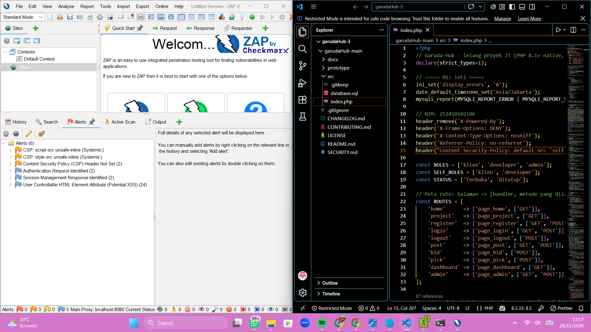

# Garuda-Hub

Website lelang proyek IT: klien memasang proyek, developer menawar, klien memilih pemenang. Dibuat untuk **studi kasus pembelajaran keamanan** mahasiswa dengan praktik PHP standar. Semua data adalah data dummy.

## PERINGATAN

- **Hanya untuk komputer lokal atau lingkungan belajar.** Jangan dipasang di server publik atau internet.
- Konfigurasi bawaan memakai database `root` dengan password kosong. Itu hanya aman di komputer lokal.
- Tidak ada pembatasan percobaan login (rate limit).
- Header keamanan dasar (`X-Frame-Options`, `Content-Security-Policy`, `X-Content-Type-Options`, `Referrer-Policy`) sudah ditambahkan pada Episode 2.
- Jangan memasukkan data pribadi atau password asli.

## Fitur

- Daftar dan login dengan peran klien, developer, admin
- Klien memasang proyek (judul, deskripsi, kategori, budget, batas lelang)
- Daftar, pencarian, dan detail proyek beserta penawaran
- Developer mengajukan penawaran (harga, durasi, proposal)
- Klien memilih pemenang
- Dasbor per peran dan panel admin

## Kebutuhan

- PHP 8.1 atau lebih baru dengan ekstensi `mysqli`
- MySQL atau MariaDB

## Instalasi

1. Klon repositori ini lalu masuk ke foldernya.
2. Impor skema dan data dummy:
   ```
   mysql -u root -p < src/database.sql
   ```
   Ini membuat database `garuda_hub` dan **menghapus** tabel `users`, `projects`, `bids` jika sudah ada.
3. (Opsional) Atur koneksi database lewat variabel lingkungan:

   | Variabel | Bawaan |
   | --- | --- |
   | `GH_DB_HOST` | `127.0.0.1` |
   | `GH_DB_USER` | `root` |
   | `GH_DB_PASS` | kosong |
   | `GH_DB_NAME` | `garuda_hub` |
   | `GH_DB_PORT` | `3306` |

   Contoh: `export GH_DB_USER=nama_pengguna_anda`
4. Jalankan server bawaan PHP:
   ```
   php -S localhost:8000 -t src
   ```
5. Buka `http://localhost:8000`.

## Akun dummy

Data awal berisi akun fiktif berdomain `example.com`: satu admin (`admin@example.com`), klien (`budi@`, `siti@`, `agus@`), dan developer (`dewi@`, `eko@`, `fitri@`, `gilang@`). Password tidak dicantumkan di sini. Anda dapat mendaftar akun baru sebagai klien atau developer lewat halaman Daftar.

## Struktur

- `src/index.php`: seluruh aplikasi (routing lewat `?page=`)
- `src/database.sql`: skema dan data dummy

## Hasil Pengujian Keamanan (Episode 2: The Phantom Vulnerability)

NIM: 252410102106

Pengamanan yang diterapkan pada aplikasi:

- **Autentikasi:** password disimpan dengan `password_hash` dan diverifikasi dengan `password_verify`.
- **Session:** cookie `HttpOnly` dan `SameSite=Lax`, `session_regenerate_id` saat login, sesi dihancurkan saat logout (hanya lewat POST).
- **CSRF:** token acak di semua form dan diperiksa pada setiap request POST.
- **SQL Injection:** seluruh query memakai prepared statement.
- **XSS:** seluruh output dienkode dengan `htmlspecialchars` (output encoding), termasuk kolom deskripsi proyek.
- **Security headers:** `X-Frame-Options`, `X-Content-Type-Options`, `Referrer-Policy`, dan `Content-Security-Policy`.

Hasil scan OWASP ZAP terhadap aplikasi lokal (`http://localhost:8000`): **tidak ada alert High maupun Critical**. Komentar NIM terlihat di kode di sebelah jendela ZAP.



## Panduan pemakaian

Lihat folder `docs/user/` bila tersedia.

## Lisensi

MIT. Lihat [LICENSE](LICENSE).
